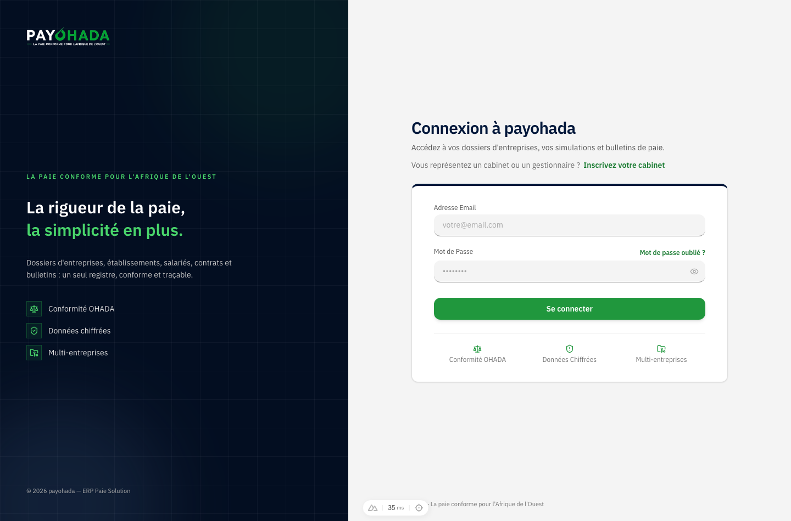
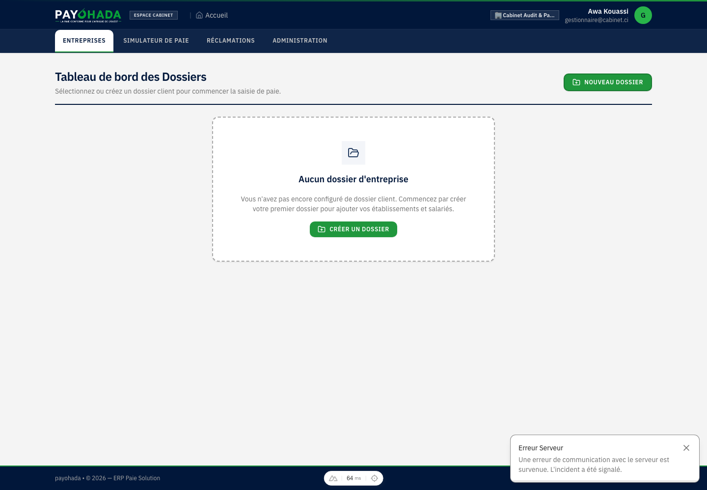

# Charte graphique — payohada

> Document de référence pour toute évolution visuelle de l'application.
> Il complète `frontend/app/assets/css/main.css`, qui reste la source unique
> des jetons (couleurs, rayons, typographie).

## 1. Les deux couleurs de la marque

Le logo `PAYOHADA` associe deux couleurs, et l'interface doit refléter ce duo :

| Couleur | Valeur | Rôle | Part dans l'interface |
|---|---|---|---|
| **Vert marque** | `#20973d` (`green-600`), échelle `green-50 → green-950` | **Action et validation.** Boutons primaires, focus, succès, montants positifs, soulignement de l'onglet actif. | **Dominante** : c'est la couleur qu'on voit en premier sur les actions. |
| **Bleu encre** | `#01173a` (`navy-900`), échelle `navy-50 → navy-950` | **Structure et autorité.** En-tête de l'application, navigation, pied de page, titres, en-têtes de tableaux, encarts d'information, documents imprimés. | **Présente partout** : c'est la couleur qui donne le cadre. |
| Gris Carbon | `slate-50 → slate-950` (jetons Carbon) | Surfaces, textes secondaires, séparateurs. | Support |

Le vert reste la couleur **primaire** (`app.config.ts`). Le bleu encre est la
couleur **secondaire** et **d'information** (`secondary` et `info` = `navy`).

## 2. Règle d'attribution des rôles

> **Structure = bleu encre. Action = vert.**
> Un élément « qui encadre, qui identifie, qui titre » est bleu.
> Un élément « qui agit, qui valide, qui progresse » est vert.

| Élément | Couleur |
|---|---|
| En-tête applicatif, barre de navigation, pied de page | `navy-900` / `navy-800` |
| Onglet actif | fond blanc, texte `navy-900`, soulignement `green-600` |
| Onglet inactif | texte `slate-300`, survol `white/5` |
| Titre de page (`h1`) et titres de section (`h2`, `h3`) | `text-navy-900` |
| Filet/séparateur de titre de page | `border-navy-900` (2 px) |
| En-têtes de tableaux | fond `navy-900`, texte blanc, filet bas `green-600` (2 px) |
| Icônes « structure » (dossier, établissement, salarié, contrat, document) | `text-navy-700` sur `bg-navy-50` |
| Bouton primaire (créer, enregistrer, valider, envoyer) | `bg-green-600` / `hover:bg-green-700` |
| Bouton secondaire, lien, action tertiaire | `text-navy-700` / `hover:text-navy-900` |
| Badge neutre / informatif | `bg-navy-50 text-navy-700 border-navy-200` |
| Badge succès, validé, actif, positif | **vert inchangé** (`bg-green-50 text-green-700 border-green-200`) |
| Montants positifs, gains, totaux créditeurs | **vert inchangé** |
| Chiffres clés (KPI) | `text-navy-900` |
| Encart d'information (info) | `bg-navy-50 border-navy-200 text-navy-800` |
| Barre de progression, spinner de chargement | **vert inchangé** |
| Focus clavier | **vert inchangé** (`outline: 2px solid var(--carbon-primary)`) |
| Barre d'accent supérieure (signature) | classe `.brand-accent-bar` (dégradé navy → vert) |

### Ce qu'il ne faut pas faire

- Ne pas colorer un **bouton d'action** en bleu : le vert reste le signal d'action.
- Ne pas transformer un **état de succès** en bleu : le vert garde ce rôle.
- Ne pas introduire une troisième famille de couleurs (rose, violet, orange…)
  en dehors des couleurs sémantiques Carbon (`danger`, `warning`).
- Ne pas mettre de texte blanc sur `navy-50/100/200` (contraste insuffisant).

## 3. Jetons disponibles

### Classes Tailwind (`@theme` dans `main.css`)

```
bg-navy-50 … bg-navy-950        text-navy-…
border-navy-…                  ring-navy-…        accent-navy-…
```

L'échelle complète : `50 #f3f5f9 · 100 #dfe6f1 · 200 #c2d0e5 · 300 #9fb2d1 ·
400 #748db4 · 500 #536b93 · 600 #3c5377 · 700 #243c60 · 800 #0f2548 ·
900 #01173a · 950 #030e21`.

### Rayons

L'interface est volontairement arrondie (demande client). L'échelle est
définie dans `@theme` ; les valeurs par défaut des composants sont :

| Usage | Classe | Valeur |
|---|---|---|
| Petits badges, puces | `rounded-xs` / `rounded-sm` | 4 / 6 px |
| Champs, boutons, petites cartes | `rounded-md` / `rounded-lg` | 8 / 10 px |
| Cartes, panneaux, onglets | `rounded-xl` | 12 px |
| Modales, grandes surfaces | `rounded-2xl` | 16 px |
| Étiquettes (gélule) | `rounded-full` | 9999 px |

Les contrôles sans classe dédiée (`input`, `select`, `textarea`, `button`)
reçoivent `--radius-md` ; les cartes qui n'ont pas de classe `rounded-*` sont
arrondies via `.shadow-flat`. En impression, tous les rayons sont remis à zéro.

### Variables sémantiques (dans `:root`)

```css
--brand-navy: #01173a;        /* encre de la marque */
--brand-navy-deep: #030e21;
--brand-navy-soft: #0f2548;
--brand-green: var(--color-green-600);
--brand-accent: linear-gradient(90deg, #01173a 0%, #20973d 100%);
```

### Classes maison

- `.brand-accent-bar` : filet de 3 px en dégradé navy → vert, signature de l'app.
- `.brand-title` : titre de page en `navy-900`, graisse 600.
- `.brand-rule` : filet inférieur 2 px navy sous un en-tête de page.
- `.brand-tile` : tuile blanche à filet `navy-200`, en-tête de tuile en navy.

## 4. Motifs à réutiliser

### En-tête de page

```html
<div class="flex flex-col sm:flex-row sm:items-center sm:justify-between border-b-2 border-navy-900 pb-4">
  <div>
    <h1 class="text-2xl font-bold text-navy-900 tracking-tight">Titre</h1>
    <p class="text-sm text-slate-500 mt-1">Sous-titre explicatif.</p>
  </div>
  <button class="… bg-green-600 hover:bg-green-700 text-white …">Action</button>
</div>
```

### Carte / tuile

```html
<div class="bg-white border border-slate-200 border-t-4 border-t-navy-900 p-5 shadow-flat">
  <h2 class="text-sm font-bold uppercase tracking-wider text-navy-900 flex items-center gap-2">
    <UIcon name="i-lucide-folder" class="w-4 h-4 text-navy-700" />
    Titre de la section
  </h2>
  …
</div>
```

### Badge informatif

```html
<span class="px-2 py-0.5 text-xs font-semibold bg-navy-50 text-navy-700 border border-navy-200">
  Information
</span>
```

### En-tête de tableau

Le style global de `main.css` s'en charge (`thead th` navy, texte blanc,
filet vert). Ne pas surcharger dans les gabarits, sauf besoin ponctuel.

## 5. Impression

Les documents imprimés (bulletins, attestations, certificats, STC) restent
**sobres** : `main.css` rétablit en `@media print` des en-têtes de tableaux
blancs à texte noir. Seuls les titres de document peuvent rester en
`navy-900`, pour rappeler la marque sans consommer d'encre.

## 6. Accessibilité

- Texte blanc sur `navy-800/900` : contraste > 12:1.
- `navy-700` sur blanc : contraste > 9:1 (titres, liens).
- `slate-300` sur `navy-900` : réservé aux onglets inactifs (décor), jamais
  au contenu essentiel.
- L'information ne doit jamais reposer **uniquement** sur la couleur : les
  badges conservent un libellé explicite.

## 7. Aperçus

Captures de référence (application réelle, données de démonstration) :

| Écran | Aperçu |
|---|---|
| Page d'accueil |  |
| Connexion |  |
| Espace cabinet — dossiers |  |
| Espace client — tableau de bord |  |
